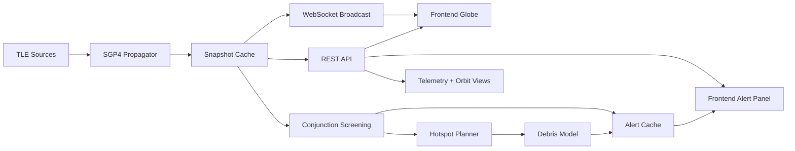
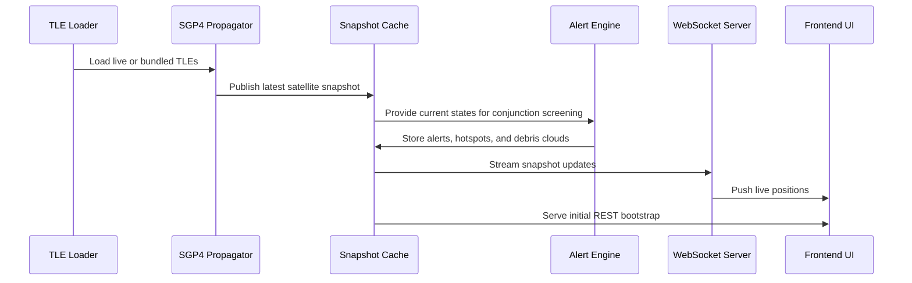
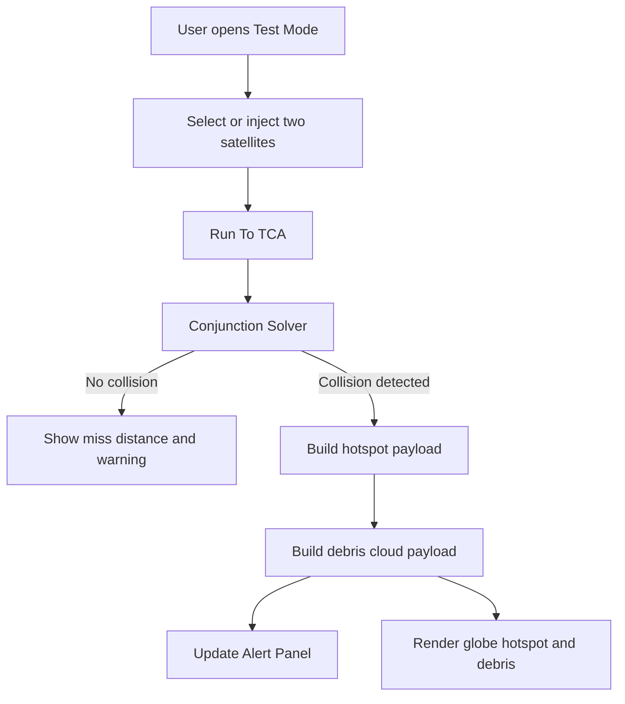
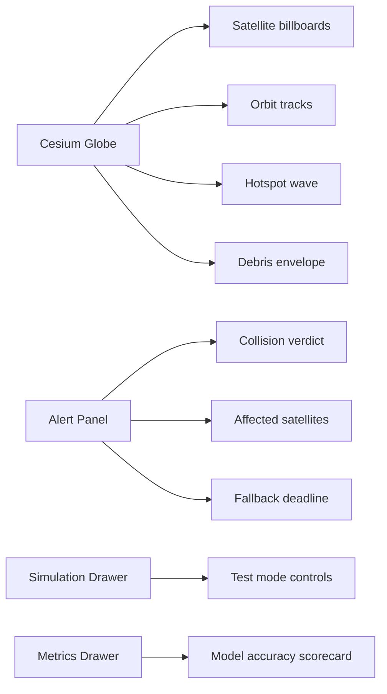

# Orbital Sentinel

Orbital Sentinel is a real-time satellite tracking and conjunction-awareness prototype. It combines live orbit propagation, alert generation, demo collision scenarios, and a Cesium-based visualization layer.

## High-Level Architecture

## Runtime Flow

## Collision Demo Flow

## Frontend View Layers

## What Each Layer Does

- Backend physics layer: propagates satellites from TLEs using SGP4.
- Conjunction layer: identifies close approaches and computes alert severity.
- Hotspot layer: turns a conjunction into a visible hotspot zone.
- Debris layer: expands the hotspot into a debris cloud and affected-satellite list.
- Frontend layer: shows the globe, alert log, simulation tools, and model scorecard.

## Main Backend Pieces

- `backend/main.py` starts the FastAPI app, refreshes snapshots, and keeps alerts warm.
- `backend/app/core/sgp4_propagator.py` computes orbit states from TLEs.
- `backend/app/core/conjunction.py` screens for close approaches.
- `backend/app/services/cascade_planner.py` builds alerts, hotspots, and maneuver guidance.
- `backend/app/services/debris_model.py` builds the debris cloud and affected targets.
- `backend/app/routers/test_mode.py` injects deterministic collision demo scenarios.

## Main Frontend Pieces

- `frontend/src/components/Globe/CesiumGlobe.jsx` renders satellites, hotspots, and debris.
- `frontend/src/components/Alert/AlertPanel.jsx` shows the incident log and affected satellites.
- `frontend/src/components/TestModePanel.jsx` runs the collision demo.
- `frontend/src/components/SimulationDrawer.jsx` keeps test controls visible.
- `frontend/src/components/MetricsDrawer.jsx` shows the model scorecard.

## Data Sources

- Live or bundled TLE data is used for orbit propagation.
- Demo collision fixtures are used for repeatable test scenarios.
- Model artifacts are used for the metrics and risk score display.

## How To Read The System

1. Satellites are propagated first.
2. The backend compares orbital states and detects conjunctions.
3. Alerts and hotspots are written to cache.
4. The frontend renders the globe and alert log.
5. The test mode can inject a deterministic collision demo.

## Status

This repository is a working prototype focused on visualization, alerting, and judge-friendly demo workflows. Some demo values are intentionally fixed so the collision scenario is repeatable, collition area is also changing depend on the location where you wanna predict the location of the collision.
